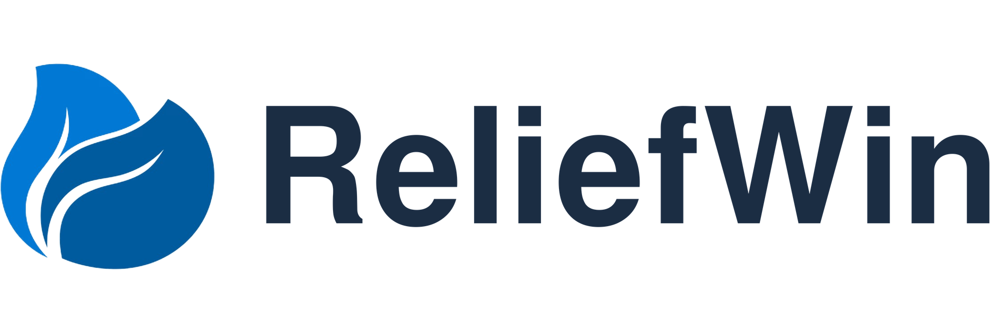

# ReliefWin

<p align="center">
  
</p>

[简体中文](translations/zh-CN/README.md) · [Installation](INSTALL.md) · [Contributing](CONTRIBUTING.md) · [运行截图](media/graphics/screenshots/README.md) · [验证记录](media/doc/RELIEFWIN_VALIDATION.md)

ReliefWin is a free NT operating system derived from LiberNT and ReactOS. It targets Windows 11 compatibility and modern hardware. The supported interface languages are Simplified Chinese (zh-CN), English (en-US) and Japanese (ja-JP). Simplified Chinese is the default; untranslated text falls back to English.

This checkout has no ReliefWin website, public release repository or update service configured. Build the source locally. Automatic operating-system updates are disabled until a maintainer configures an endpoint. Upstream toolchain and third-party package downloads retain their real addresses.

The maintainer supplied the replacement logo in `media/graphics/branding/reliefwin-source.jpg`. Branding resources are generated from that image; see [TRADEMARK.md](TRADEMARK.md). Original author and licence notices remain intact.

## Booting and installation

Build `reliefwinimg` for a preinstalled `ReliefWin.img`, or `bootcd` for an installation `bootcd.iso`. The source supports amd64, i386, arm64 and ports in progress. Availability of source code does not establish working hardware support.

Start `ReliefWin.img` in a virtual machine, or write it to spare boot media. Writing a raw disk image erases the target device. Boot `bootcd.iso` to run ReliefWin Setup. The preinstalled image also includes `C:\<architecture>\reliefwin.exe`.

## Building ReliefWin Yourself

ReliefWin builds with RosBE, a cross-build toolchain. The steps below work on Linux and macOS, and on Windows through WSL2.

### 1. Install the toolchain

You need CMake 3.24 or newer, Python 3.9 or newer, Git, Ninja and a native C/C++ compiler. RosBE adds the compilers that build ReliefWin. `configure.sh` checks host dependencies before building the configuration tool and installs missing packages on Debian/Ubuntu and Arch Linux. A failed dependency check stops configuration.

On Arch Linux, install the host dependencies with:

```sh
sudo pacman -S --needed base-devel git cmake ninja flex bison m4 ccache curl wget xz tar patch pkgconf python python-mako python-yaml python-packaging glslang msitools
```

```sh
curl -fsSL https://raw.githubusercontent.com/LiberNT/libernt-build-toolchain/main/rosbe-unix-bootstrap.sh | sh
```

> [!TIP]
> On Windows, we suggest WSL2. Install it with `wsl --install`, open the Linux terminal it adds, and follow the Linux steps there. Keep the source inside the Linux file system rather than under `/mnt/c`, where builds run slower.

### 2. Get the source

```sh
git clone https://github.com/Leonmmcoset/ReliefWin.git
cd ReliefWin
```

> [!NOTE]
> The first configure run fetches the external sources needed by the selected components. Mesa and DXC are fetched for supported Clang targets; the debugger and ARM64 emulators use the FEX feed. FFmpeg source is fetched when `FFMPEG_FROM_SOURCE=ON`. Feed access and release payload downloads require an Internet connection. Use `--no-feeds-update` only after preparing those sources.

### 3. Configure

```sh
./configure.sh
```

With no options, this sets up an AMD64 Debug build with Clang in the folder `output-Clang-amd64-debug`. The folder name always follows the pattern `output-<compiler>-<architecture>-<debug|release>`.

| Option | What it does |
| --- | --- |
| `-a`, `--arch <arch>` | Chooses the target architecture: `amd64` (default), `i386`, `arm64` or `riscv64`. |
| `--clang` | Builds with Clang/LLVM from RosBE. This is the default. |
| `--gcc` | Builds with GCC from RosBE instead of Clang. The macOS RosBE does not include GCC. |
| `-r`, `--release` | Makes an optimized Release build. Without it you get a Debug build, which is easier to debug. |
| `menuconfig` | Opens a menu to choose optional components first. Your choices are kept in the output folder. |
| `makefiles` | Uses `make` instead of Ninja. |
| `--no-feeds-update` | Skips fetching the external sources listed in `feeds.conf`, for example when offline. |
| `-D<name>=<value>` | Passes a setting straight to CMake. |

For example:

```sh
./configure.sh -a arm64              # ARM64 Debug build with Clang
./configure.sh -a i386 --gcc         # 32-bit x86 build with GCC
./configure.sh -a amd64 --release    # optimized AMD64 build
```

For a more personalized build, add `menuconfig`:

```sh
./configure.sh menuconfig
```

It opens a menu, much like the Linux kernel's, where you choose the target, compiler and build type, and switch features on or off: code generation and tuning, graphics driver model and Mesa, WoW64 and FEX, kernel debugging, test runs and more. Press `?` on any option for help, `S` to save and `Q` to quit. Your choices are saved in the output folder and used every time you configure it again.

### 4. Build

Go to the output folder and run Ninja with the target you want:

```sh
cd output-Clang-amd64-debug
ninja reliefwinimg
```

| Command | Creates | Use it to |
| --- | --- | --- |
| `ninja bootcd` | `bootcd.iso` | Install ReliefWin from a CD image, in a virtual machine or on a PC. |
| `ninja reliefwinimg` | `ReliefWin.img` | Boot a disk with ReliefWin already installed. Start it in a virtual machine such as QEMU, or write it to a USB drive or SD card. It boots with UEFI or BIOS. |
| `ninja reliefwinvhd` | `ReliefWin.vhd`, `ReliefWin.vhdx` | Use the same preinstalled disk in virtual machines: the VHD in VirtualBox and Hyper-V Generation 1, the VHDX in Hyper-V Generation 2, which does not take VHD disks. |

Each target builds everything it needs first, and the files are written to the output folder.

---

## Build Hosts

| Host | Compilers | Notes |
| --- | --- | --- |
| **Linux** x86_64 / aarch64 | Clang and GCC | The full RosBE toolchain |
| **macOS** Intel / Apple Silicon | Clang | RosBE has no GCC build for macOS |
| **Windows** | Clang and GCC | Through WSL2, following the Linux steps |

On other hosts, install Git, CMake 3.24+, Ninja, a native C/C++ compiler, Make, Flex, Bison, M4, ccache, curl, wget, xz, tar, patch, pkg-config, glslang and msitools from your package manager. Install Python 3.9+ with the Mako, PyYAML and packaging modules in the interpreter used by the build. RosBE provides the cross compilers and matching runtime sources. The upstream build toolchains are available in [LiberNT/libernt-build-toolchain](https://github.com/LiberNT/libernt-build-toolchain).

See [全新设备构建说明](media/doc/BUILDING.md) for the complete installation-ISO workflow and the scope of build validation.

---

## Project Structure

```text
ReliefWin/
├── base/            # Applications, services, setup and the shell
├── boot/            # FreeLoader, boot data and boot images
├── bootloader/      # Boot manager, Windows loader, UEFI and Open Firmware support
├── dll/             # User-mode DLLs, including ntdll and the Win32 libraries
├── drivers/         # Kernel-mode drivers: buses, storage, file systems, network, input and more
├── hal/             # Hardware abstraction layers for x86, Arm, Arm64, PowerPC and RISC-V
├── media/           # Fonts, themes, INF files, sounds and branding
├── modules/         # Optional applications, tests and wallpapers
├── ntos/            # The NT kernel and executive
├── sdk/             # Headers, libraries and build tools
├── submodules/      # Recipes and patches for external components
├── subsystems/      # CSRSS and the Windows subsystem
│   └── win/win32k/  # win32k, USER, GDI and display drivers
├── configure.sh     # Sets up a build on Linux, macOS and WSL2
└── configure.cmd    # Sets up a build on Windows
```

---

## Attribution and licence

Inherited LiberNT, ReactOS, Wine and third-party work keeps its original copyright holders and per-file licence. See [CREDITS.md](CREDITS.md), [COPYING](COPYING), [COPYING2](COPYING2) and [COPYING.LIB](COPYING.LIB).

The upstream source is [LiberNT/LiberNT](https://github.com/LiberNT/LiberNT). Its releases and services are upstream resources and are not ReliefWin downloads or support endpoints. ReliefWin is independent of Microsoft and the upstream projects. Windows is a trademark of Microsoft Corporation.

## Verification

Run `python3 sdk/tools/check_branding.py` to check source branding, default language, update defaults and preserved attribution. See `media/doc/RELIEFWIN_VALIDATION.md` for the build and runtime results of this change.
