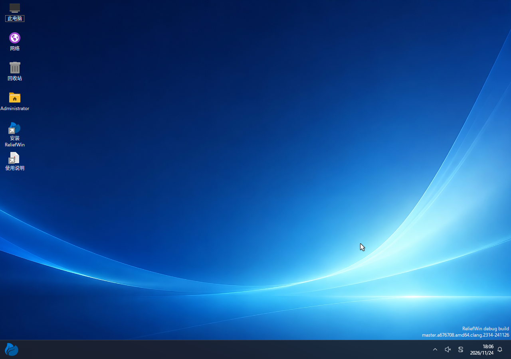

# ReliefWin 实际运行截图

这些截图来自本次源码构建的 amd64 `ReliefWin.img`，通过无显示窗口的 QEMU 实际启动并用 QMP 转储屏幕，分辨率为 1280 × 900。PNG 是屏幕像素的无损转换，没有合成或修饰。默认界面为简体中文。

| 系统位置 | 截图 |
| --- | --- |
| 启动画面 | [查看](boot.png) |
| 桌面与任务栏 | [查看](desktop.png) |
| 开始菜单 | [查看](start.png) |
| 关于 ReliefWin | [查看](winver.png) |
| 设置中的系统信息 | [查看](settings.png) |
| 系统属性 | [查看](sysdm.png) |
| 更新设置 | [查看](updates.png) |
| 安装语言与键盘 | [查看](setup.png) |
| 首次配置中的账户页面 | [查看](oobe-account.png) |
| 可选组件 | [查看](oobe-components.png) |
| 命令提示符 | [查看](console.png) |

启动图中的 TianoCore 标志和灰色日志来自测试虚拟机的 OVMF 固件。关于对话框中的原作者版权仍按来源保留；它与当前 ReliefWin 产品名称、Logo 分开显示。命令提示符中的 `ver` 保留 NT10 兼容输出，随后实际查询注册表所得的 ProductName 为 ReliefWin。可选组件中标为上游软件包的项目保留真实来源，不是本项目的更新服务。

构建、镜像审计、测试结果及未验证范围见[验证记录](../../doc/RELIEFWIN_VALIDATION.md)。
