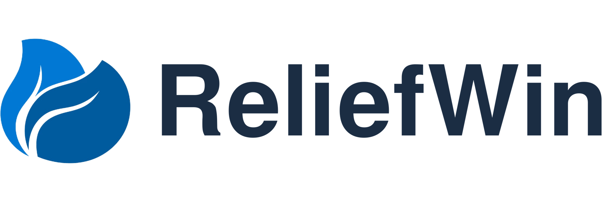

> ReliefWin 默认使用简体中文。目前没有配置 ReliefWin 官网、公开下载仓库或更新服务。请从本地源码构建；系统默认关闭自动更新。上游构建依赖保留真实下载地址。

<div dir="rtl" lang="ar">

> [English](../../README.md) | [中文](../zh-CN/README.md) | [Français](../fr-FR/README.md) | [Español](../es-ES/README.md) | [日本語](../ja-JP/README.md) | **العربية** | [Українська](../uk-UA/README.md)

<p align="center">
  
</p>


<div align="center">

# ReliefWin
### نظام تشغيل NT حر

**صُنع حبًّا في معمارية NT. متوافق مع Windows® 11، لمعماريات amd64 وarm64 وriscv64.**


<br>


</div>

## الرعاة


---


---


يقدّم ReliefWin عملًا واسعًا على مكونات فضاء النواة وبرامج التشغيل، موجّهًا نحو الاستقرار والعتاد الحديث، ويركّز على منصات 64 بت: **amd64 وarm64 وriscv64**.

هدفنا نظام يبقى قابلًا للصيانة على المدى الطويل: **مستقر وموثوق وفعّال**، يعمل أيضًا على الأجهزة المدمجة، وقادر على دعم كل ميزة ينبغي أن يوفرها نظام تشغيل حديث.

> [!NOTE]
> جديد على NT؟ **NT** هي المعمارية التي تقوم عليها كل الإصدارات الحديثة من Windows: نواتها ونموذج برامج التشغيل وخدمات النظام. ReliefWin نظام تشغيل حر مبني على هذه المعمارية، ويتخذ من Windows 11 مرجعًا يقيس نفسه به.

---

## جدول المحتويات

- [ما الذي يتضمنه ReliefWin](#ما-الذي-يتضمنه-reliefwin)
- [المنصات المدعومة](#المنصات-المدعومة)
- [البدء](#البدء)
  - [الخطوة 1: تنزيل نسخة](#الخطوة-1-تنزيل-نسخة)
  - [الخطوة 2: الإقلاع](#الخطوة-2-الإقلاع)
  - [الخطوة 3: تثبيت ReliefWin](#الخطوة-3-تثبيت-reliefwin)
- [بناء ReliefWin بنفسك](#بناء-reliefwin-بنفسك)
- [أنظمة البناء](#أنظمة-البناء)
- [بنية المشروع](#بنية-المشروع)
- [المساهمة](#المساهمة)
- [استخدام الذكاء الاصطناعي](#استخدام-الذكاء-الاصطناعي)
- [الترخيص](#الترخيص)
- [حول المشروع](#حول-المشروع)

---

## ما الذي يتضمنه ReliefWin

يجلب ReliefWin العتاد والمنصات الحديثة إلى معمارية NT.

| الميزة | ما تعنيه لك |
| --- | --- |
| **64 بت أولًا** | تعمل النواة وطبقة HAL وFreeLoader على amd64 وarm64 وriscv64. |
| **الإقلاع عبر UEFI** | يقلع على برامج UEFI الثابتة، مع مخزن إطارات GOP ودعم مبكر للشاشة. ويقلع القرص المثبّت مسبقًا عبر UEFI أو BIOS. |
| **ناقلات وتخزين حديثة** | PCIe وPCI والتوصيل والتشغيل (Plug and Play) وUSB عبر xHCI وSD/eMMC، إضافة إلى برامج تشغيل التخزين والناقلات. |
| **دعم اللوحات** | لوحات حقيقية، منها Raspberry Pi ووحدة التحكم في الإدخال والإخراج RP1 الخاصة بها. |
| **نموذج برامج التشغيل في Windows 11** | التوافق مع Windows 11 (NT10) والعمل على نموذج برامج التشغيل، مع التحقق من ذلك مقارنةً بـ Windows 11 نفسه. |
| **الرسوميات وتطبيقات x86 على Arm** | نموذج برامج تشغيل الرسوميات مع Mesa، وWoW64 مع FEX، خيارات بناء يمكنك تفعيلها. |
| **برنامج إعداد ReliefWin** | يعرض الأقراص كما يفعل برنامج إعداد Windows، وينشئ الأقسام ويحذفها ويهيئها ويقلّصها ويوسّعها، ويثبّت ReliefWin على NTFS مع قسم نظام EFI الذي يحتاجه. |
| **نسختك الخاصة** | تتيح لك ‎`menuconfig`‎ اختيار الهدف والمترجم ونوع البناء، وتفعيل الميزات أو تعطيلها. |


---

## المنصات المدعومة

| المعمارية | صور جاهزة | البناء من المصدر | ملاحظات |
| --- | :---: | :---: | --- |
| **amd64** | ✓ | ✓ | Clang (الافتراضي) أو GCC |
| **arm64** | ✓ | ✓ | يتضمن دعم Raspberry Pi |
| **riscv64** | ✓ | ✓ | تُبنى صورة منفصلة للوحات JH7110 |
| **i386** | | ✓ | x86 بمعمارية 32 بت |

تتضمن نسخ الإصدار أيضًا صورًا لـ PowerPC.

---

## البدء

### الخطوة 1: تنزيل نسخة


| الملف | ما هو |
| --- | --- |
| ‎`bootcd-iso-…-<arch>-…zip`‎ | ‎`bootcd.iso`‎، صورة قرص مضغوط تشغّل ReliefWin أو تبدأ برنامج إعداد ReliefWin |
| ‎`ReliefWin-img-…-<arch>-…zip`‎ | ‎`ReliefWin.img`‎، قرص مثبّت عليه ReliefWin مسبقًا |
| ‎`ReliefWin-vhd-…-<arch>-…zip`‎ | ‎`ReliefWin.vhd`‎، القرص المثبّت مسبقًا نفسه للآلات الافتراضية التي تعتمد VHD |
| ‎`ReliefWin-vhdx-…-<arch>-…zip`‎ | ‎`ReliefWin.vhdx`‎، القرص المثبّت مسبقًا نفسه لـ Hyper-V من الجيل الثاني |

> [!NOTE]
> هذه نسخ Debug مبنية بـ Clang، تنتجها GitHub Actions من الفرع ‎`master`‎.

### الخطوة 2: الإقلاع

أسرع طريقة لتجربة ReliefWin هي القرص المثبّت مسبقًا:

1. فك ضغط ‎`ReliefWin.img`‎ (أو ‎`ReliefWin.vhd`‎)
2. شغّله في آلة افتراضية مثل **QEMU**، أو استخدم ملف VHD في **VirtualBox** أو في آلة افتراضية **Hyper-V** من الجيل الأول. لا يقبل Hyper-V من الجيل الثاني إلا ‎`ReliefWin.vhdx`‎، مع تعطيل الإقلاع الآمن
3. أو اكتب ‎`ReliefWin.img`‎ على وحدة USB أو بطاقة SD وأقلع الجهاز منها. يقلع عبر UEFI أو BIOS

> [!CAUTION]
> كتابة ‎`ReliefWin.img`‎ على وحدة USB أو بطاقة SD تمحو كل ما عليها. تحقّق جيدًا من الجهاز الهدف قبل ذلك.

### الخطوة 3: تثبيت ReliefWin

أقلع ‎`bootcd.iso`‎ في آلة افتراضية أو على حاسوب، واتبع تعليمات **برنامج إعداد ReliefWin**.

يحمل القرص المثبّت مسبقًا أيضًا برنامج إعداد ReliefWin. شغّل ‎`C:\<المعمارية>\reliefwin.exe`‎، مثلًا ‎`C:\arm64\reliefwin.exe`‎، لتثبيت ReliefWin على قرص آخر من النظام قيد التشغيل.

> [!CAUTION]
> يستطيع برنامج الإعداد حذف الأقسام وتهيئتها. انسخ احتياطيًا كل ما هو مهم على القرص الهدف قبل التثبيت.

راجع [INSTALL.md](INSTALL.md) للاطلاع على دليل التثبيت الكامل.

---

## بناء ReliefWin بنفسك

يُبنى ReliefWin باستخدام RosBE، وهي سلسلة أدوات للبناء المتقاطع. تعمل الخطوات التالية على Linux وmacOS، وعلى Windows عبر WSL2.

### 1. تثبيت سلسلة الأدوات

تحتاج إلى Git وCMake وNinja ومترجم C/C++ لجهازك. يضيف RosBE المترجمات التي تبني ReliefWin.

<div dir="ltr">

```sh
curl -fsSL https://raw.githubusercontent.com/LiberNT/libernt-build-toolchain/main/rosbe-unix-bootstrap.sh | sh
```

</div>

> [!TIP]
> على Windows، ننصح باستخدام WSL2. ثبّته بالأمر ‎`wsl --install`‎، وافتح طرفية Linux التي يضيفها، واتبع فيها خطوات Linux. احتفظ بالمصدر داخل نظام ملفات Linux بدلًا من ‎`/mnt/c`‎، حيث يكون البناء أبطأ.

### 2. الحصول على المصدر

<div dir="ltr">

```sh
cd /path/to/ReliefWin
```

</div>

> [!NOTE]
> يجلب أول تشغيل للإعداد أيضًا الوحدة الفرعية والمصادر الخارجية التي يحتاجها البناء.

### 3. الإعداد

<div dir="ltr">

```sh
./configure.sh
```

</div>

دون أي خيار، يجهّز هذا الأمر بناء AMD64 من نوع Debug باستخدام Clang في المجلد ‎`output-Clang-amd64-debug`‎. يتبع اسم المجلد دائمًا النمط ‎`output-<المترجم>-<المعمارية>-<debug|release>`‎.

| الخيار | ما يفعله |
| --- | --- |
| ‎`-a`‎، ‎`--arch <arch>`‎ | يختار المعمارية الهدف: ‎`amd64`‎ (الافتراضية) أو ‎`i386`‎ أو ‎`arm64`‎ أو ‎`riscv64`‎. |
| ‎`--clang`‎ | يبني باستخدام Clang/LLVM من RosBE. وهذا هو الافتراضي. |
| ‎`--gcc`‎ | يبني باستخدام GCC من RosBE بدلًا من Clang. نسخة RosBE لـ macOS لا تتضمن GCC. |
| ‎`-r`‎، ‎`--release`‎ | ينتج بناء Release محسّنًا. من دونه تحصل على بناء Debug، وهو أسهل في التنقيح. |
| ‎`menuconfig`‎ | يفتح قائمة أولًا لاختيار المكونات الاختيارية. تُحفظ اختياراتك في مجلد الإخراج. |
| ‎`makefiles`‎ | يستخدم ‎`make`‎ بدلًا من Ninja. |
| ‎`--no-feeds-update`‎ | يتخطى جلب المصادر الخارجية المذكورة في ‎`feeds.conf`‎، مثلًا عند العمل دون اتصال. |
| ‎`-D<name>=<value>`‎ | يمرّر إعدادًا مباشرة إلى CMake. |

على سبيل المثال:

<div dir="ltr">

```sh
./configure.sh -a arm64              # بناء ARM64 من نوع Debug باستخدام Clang
./configure.sh -a i386 --gcc         # بناء x86 بمعمارية 32 بت باستخدام GCC
./configure.sh -a amd64 --release    # بناء AMD64 محسّن
```

</div>

لبناء أكثر تخصيصًا، أضف ‎`menuconfig`‎:

<div dir="ltr">

```sh
./configure.sh menuconfig
```

</div>

يفتح قائمة، تشبه كثيرًا قائمة نواة Linux، تختار فيها الهدف والمترجم ونوع البناء، وتفعّل الميزات أو تعطّلها: توليد الشيفرة وضبطها، ونموذج برامج تشغيل الرسوميات وMesa، وWoW64 وFEX، وتنقيح النواة، وتشغيل الاختبارات، وغير ذلك. اضغط ‎`?`‎ على أي خيار للمساعدة، و‎`S`‎ للحفظ، و‎`Q`‎ للخروج. تُحفظ اختياراتك في مجلد الإخراج وتُستخدم في كل مرة تعيد فيها إعداده.

### 4. البناء

انتقل إلى مجلد الإخراج وشغّل Ninja مع الهدف الذي تريده:

<div dir="ltr">

```sh
cd output-Clang-amd64-debug
ninja reliefwinimg
```

</div>

| الأمر | ينشئ | استخدمه من أجل |
| --- | --- | --- |
| ‎`ninja bootcd`‎ | ‎`bootcd.iso`‎ | تثبيت ReliefWin من صورة قرص مضغوط، في آلة افتراضية أو على حاسوب. |
| ‎`ninja reliefwinimg`‎ | ‎`ReliefWin.img`‎ | إقلاع قرص مثبّت عليه ReliefWin مسبقًا. شغّله في آلة افتراضية مثل QEMU، أو اكتبه على وحدة USB أو بطاقة SD. يقلع عبر UEFI أو BIOS. |
| ‎`ninja reliefwinvhd`‎ | ‎`ReliefWin.vhd`‎، ‎`ReliefWin.vhdx`‎ | استخدام القرص المثبّت مسبقًا نفسه في الآلات الافتراضية: VHD في VirtualBox وHyper-V من الجيل الأول، وVHDX في Hyper-V من الجيل الثاني الذي لا يقبل أقراص VHD. |

يبني كل هدف أولًا كل ما يحتاجه، وتُكتب الملفات في مجلد الإخراج.

---

## أنظمة البناء

| النظام | المترجمات | ملاحظات |
| --- | --- | --- |
| **Linux** x86_64 / aarch64 | Clang وGCC | سلسلة أدوات RosBE كاملة |
| **macOS** Intel / Apple Silicon | Clang | لا يوفر RosBE نسخة GCC لـ macOS |
| **Windows** | Clang وGCC | عبر WSL2، باتباع خطوات Linux |

على كل نظام، ثبّت Git وCMake وNinja وFlex وBison من مدير الحزم لديك. لا يوفر RosBE إلا المترجمات المتقاطعة. توجد سلاسل الأدوات الجاهزة في [upstream RosBE](https://github.com/LiberNT/libernt-build-toolchain).

---

## بنية المشروع

<div dir="ltr">

```text
ReliefWin/
├── base/            # التطبيقات والخدمات وبرنامج الإعداد والصدفة
├── boot/            # FreeLoader وبيانات الإقلاع وصور الإقلاع
├── bootloader/      # مدير الإقلاع ومحمّل Windows ودعم UEFI وOpen Firmware
├── dll/             # مكتبات DLL في وضع المستخدم، ومنها ntdll ومكتبات Win32
├── drivers/         # برامج التشغيل في وضع النواة: الناقلات والتخزين وأنظمة الملفات والشبكة والإدخال وغيرها
├── hal/             # طبقات تجريد العتاد لـ x86 وArm وArm64 وPowerPC وRISC-V
├── media/           # الخطوط والسمات وملفات INF والأصوات والهوية البصرية
├── modules/         # تطبيقات اختيارية واختبارات وخلفيات
├── ntos/            # نواة NT والطبقة التنفيذية
├── sdk/             # الترويسات والمكتبات وأدوات البناء
├── submodules/      # وصفات المكونات الخارجية ورقعها
├── subsystems/      # CSRSS ونظام Windows الفرعي
│   └── win/win32k/  # win32k وUSER وGDI وبرامج تشغيل العرض
├── configure.sh     # يجهّز البناء على Linux وmacOS وWSL2
└── configure.cmd    # يجهّز البناء على Windows
```

</div>

---

## المساهمة

أبلغ عن الأخطاء واقترح الميزات في Issues، وستجد الأدلة والملاحظات في Wiki.


> [!WARNING]
> **تنبيه قانوني:** إذا كنت قد اطّلعت على الشيفرة المصدرية المملوكة لـ Microsoft Windows (بما في ذلك على سبيل المثال لا الحصر الشيفرة المسرّبة لـ Windows NT 3.5 وNT 4 و2000، وWindows Research Kernel)، فلن تُقبل مساهمتك بسبب احتمال انتهاك حقوق النشر.

---

## استخدام الذكاء الاصطناعي

نريد أن نكون واضحين: الذكاء الاصطناعي جزء من طريقة بناء ReliefWin. فهو يساعدنا في مراجعة الشيفرة وكتابتها، وكل ما يكتبه يراجعه إنسان بعد ذلك. وقبل أن يصل أي شيء إلى الفرع الرئيسي، يشغّل شخص اختبارات شاملة من البداية إلى النهاية ويتحقق منها. نحن نهتم بهذا المشروع أكثر من أن نترك تراجعًا يمرّ دون أن نلاحظه.

ويساعدنا أيضًا في قراءة التوثيق واستخراج التعريفات وإصلاح الأخطاء. فلكل خطأ، يقارن ما يقوله التوثيق الرسمي في Microsoft Learn بما تفعله دالتنا فعلًا، لنرى بالضبط أين يختلف سلوكنا.

ومثل أي أداة أخرى، الذكاء الاصطناعي موجود لمساعدتنا على تحقيق أهدافنا. وهو يتبع القواعد نفسها التي نلزم بها أنفسنا، والمحددة في [AGENTS.md](../../AGENTS.md):

- نبني اعتمادًا على ترويسات Windows SDK وWDK، والرموز العامة لـ Windows 11، وتوثيق Microsoft، والتشغيل كصندوق أسود على Windows 11.
- نعمل بأسلوب الغرفة النظيفة: لا ننسخ أبدًا شيفرة Windows مفككة أو معاد تجميعها، ولا ننسخ أبدًا شيفرة GPL من Linux.
- لا يُعدّ الإصلاح إصلاحًا إلا بعد أن نراه يعمل في إقلاع حقيقي أو تشغيل للاختبارات. وبعد نجاح الاختبارات، سيحافظ نظام CI مستقبلي على نجاحها ويحفظ تقدّمنا العام.
- نقارن نتائج اختباراتنا، فحصًا بفحص، بنتائج الاختبارات نفسها عند تشغيلها على Windows 11.

> [!TIP]
> إذا كنت تستخدم الذكاء الاصطناعي في مساهماتك، فأنت مرحّب بك أيضًا. فقط أخبرنا في طلب السحب بالأجزاء التي ساعد فيها وكيف اختبرتها. هذه الصراحة هي كل ما نطلبه.

---

## الترخيص

يُرخَّص ReliefWin بموجب [GNU GPL 3.0](../../COPYING). وتحتفظ الشيفرة الموروثة من مشاريع أخرى بالترخيص المذكور في ترويسات ملفاتها، ومعظمها GPL 2.0 أو أحدث. نصوص GPL 2.0 وLGPL 2.1 وBSD التي تشير إليها تلك الملفات موجودة في [COPYING2](../../COPYING2) و[COPYING.LIB](../../COPYING.LIB) و[COPYING.ARM](../../COPYING.ARM).

التغييرات التي أُجريت في LiberNT محمية بحقوق النشر © 2026 لمساهمي LiberNT. وتحتفظ الشيفرة الموروثة وشيفرة الأطراف الثالثة بإشعارات حقوق النشر الخاصة بمؤلفيها. راجع [CREDITS.md](../../CREDITS.md).

ReliefWin مشروع مستقل. وهو غير تابع لشركة Microsoft، ولا تؤيده ولا ترعاه. Windows® علامة تجارية مسجلة لشركة Microsoft Corporation.

---

## حول المشروع

ReliefWin مشتق من مشروعي LiberNT وReactOS. مؤلفو الشيفرة الموروثة مذكورون في [CREDITS.md](../../CREDITS.md).


</div>
